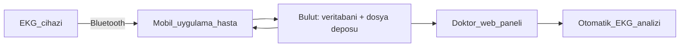
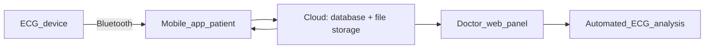

# Uçtan Uca 12 Derivasyonlu EKG Platformu — Cihaz, Mobil Uygulama ve Doktor Paneli

*End-to-End 12-Lead ECG Platform — Device, Mobile App, and Doctor Panel*

[Türkçe](#türkçe) · [English](#english)

> **Gizlilik / Confidentiality:** Bu sayfa ticari bir ürün için yapılan işi ve mimari yaklaşımı özetler; kaynak kod, donanım detayları ve protokoller **fikri mülkiyet (IP) ve NDA** kapsamında paylaşılmaz. / This page summarizes work on a commercial product; source code, hardware details, and protocols are not shared under **IP and NDA** obligations.

---

## Türkçe

### Özet

**Cormetry Health** bünyesinde geliştirilen, taşınabilir bir 12 derivasyonlu EKG cihazından Bluetooth ile veri alan **mobil uygulama**, kayıtları güvenli şekilde saklayan **bulut altyapısı** ve kayıtları inceleyip analiz eden **doktor web paneli**nden oluşan uçtan uca bir platform. Platformda **hasta ve doktor rolleri** vardır: hasta kaydı kendi cihazıyla alır, kayıt otomatik olarak buluta yüklenir; **doktor yalnızca kendisine atanmış hastaları** ve onların kayıtlarını görür.

| | |
|---|---|
| **Rol** | Ar-Ge Mühendisi / Proje Yürütücüsü (TÜBİTAK 1512). Yazılım tarafının tamamı (mobil, web, backend, cihaz entegrasyonu); firmware ve PCB entegrasyonu |
| **Dönem** | 2024 – güncel |
| **Kurum** | Cormetry Health Teknoloji A.Ş. |
| **Alan** | Kardiyoloji / dijital sağlık / medikal cihaz yazılımı |
| **Çekirdek teknolojiler** | React Native (Expo), React + Vite, TypeScript, Supabase (PostgreSQL, Auth, Storage, RLS), Bluetooth Low Energy |

**Öne çıkanlar**

- Cihazdan buluta, buluttan doktor ekranına kadar **tüm yazılım hattını tek başıma** tasarlayıp geliştirdim.
- **Hasta / doktor rolleri** ve **veritabanı düzeyinde veri izolasyonu**: her doktor yalnızca kendi hastalarını, her hasta yalnızca kendi kayıtlarını görür.
- 8 fiziksel kanaldan **12 derivasyonlu**, EKG kâğıdı görünümünde inceleme (mobil ve web).
- Makine öğrenmesi kullanmayan, **açıklanabilir, kural tabanlı otomatik EKG analizi**.
- Bluetooth üzerinde veri kaybına dayanıklı sinyal işleme ve simülatörle doğrulanmış kalibrasyon.
- Dış tedarikçiden alınan firmware ve PCB geliştirmesinin **yazılım gereksinimlerine göre entegrasyonu ve gerçek cihazla doğrulanması**.
- **TÜBİTAK BİGG 1512** projesinin uçtan uca yürütülmesi: iş planı, dönem raporları, bütçe takibi, hakem sunumu ve canlı prototip demosu.

### Problem

Klinik EKG cihazları pahalı, sabit ve verileri paylaşmak zahmetli. Hedef; hastanın taşınabilir bir cihazla kaydı kendisinin alabildiği, kaydın otomatik olarak buluta yüklendiği ve atanmış doktorun kaydı web üzerinden profesyonel EKG görünümünde inceleyebildiği bir sistem kurmaktı.

### Çözüm

1. **EKG cihazı:** Medikal sınıf 24-bit analog ön uç, mikrodenetleyici ve BLE modülünden oluşan, 10 elektrotla 500 örnek/saniye ölçüm yapan taşınabilir cihaz.
2. **Mobil uygulama (hasta):** Cihazı bulur, bağlanır, kısa bir EKG kaydı alır, sinyali işler ve buluta yükler. Geçmiş kayıtlar 12 derivasyonlu EKG kâğıdı görünümünde izlenir.
3. **Doktor web paneli:** Doktor kendisine atanmış hastaları ve kayıtlarını görür, filtrelenmiş 12 derivasyon görünümünü inceler ve otomatik analiz sonuçlarını okur.

### Roller ve veri güvenliği

- **Hasta:** Kaydı kendisi alır; yalnızca kendi kayıtlarını görür.
- **Doktor:** Yalnızca kendisine atanmış hastaları ve onların kayıtlarını görür, yönetir ve inceler.
- Yetkilendirme uygulama katmanında değil, **veritabanı katmanında (Row Level Security)** uygulanır; aynı kural kayıt dosyalarının saklandığı depoya da uygulanır.
- Rol ve modül erişim mantığı mobil ve web için **ortak bir katmanda** tutulur.

### Mobil uygulama

- Bluetooth Low Energy ile cihaz tarama, bağlantı ve kararlı veri akışı; bağlantı hatalarına karşı yeniden deneme.
- Kayıt oturumu: ham veri ve kayıt bilgileri otomatik olarak buluta yüklenir.
- EKG kâğıdı ızgarası üzerinde 12 derivasyon görüntüleyici; kullanıcının seçebildiği dijital filtreler (yüksek geçiren, alçak geçiren, şebeke paraziti).

### Doktor web paneli

- Hasta listesi, hasta bazlı kayıt geçmişi ve profil sayfaları.
- Mobil ile aynı sinyal işleme hattını kullanan 12 derivasyon EKG monitörü.
- Kayıt yönetimi (yeniden adlandırma, silme, ham veriyi indirme).
- **Açıklanabilir, kural tabanlı EKG analizi:**
  - Sinyal kalitesi (taban hattı kayması, şebeke paraziti, artefakt, elektrot teması).
  - Vuru tespiti ve dalga sınırları; temel aralık ölçümleri (RR, PR, QRS, QT / QTc).
  - Elektriksel aks.
  - Ritim, ileti, ST-T ve hipertrofi bulguları.

### Sinyal işleme

- Cihazdan gelen ham sinyalin uçtan uca işlenmesi: bayttan milivolta, kanaldan derivasyona, oradan analize.
- Bluetooth üzerinde oluşabilen veri kayıplarına karşı **kendini toparlayan** bir çözümleme yaklaşımı.
- 8 fiziksel kanaldan standart formüllerle **12 derivasyon** türetilmesi.
- Klinik ölçeğe dönüşümün bir **EKG simülatörüyle doğrulanması**.

### Mimari ve kod kalitesi

- Mobil ve web uygulamaları tek bir **monorepo** içinde; iki platformda paylaşılan rol/erişim katmanı.
- Her iki uygulamada da katmanlı (feature-sliced) mimari.
- Ortak tasarım token'ları ve bileşenlerden oluşan bir tasarım sistemi.
- Fiziksel cihazla geliştirmeyi hızlandıran otomasyon scriptleri ve Android build profilleri.

### TÜBİTAK BİGG 1512 proje yürütmesi

Proje, **TÜBİTAK BİGG 1512** kapsamında **900.000 TL hibe** ile desteklendi. Projeyi uçtan uca yürüttüm:

- İş planına göre iş-zaman, kapsam ve bütçe takibi; dönem raporları.
- TÜBİTAK hakem değerlendirmelerinde proje sunumu ve prototipin canlı demosu.

### Donanım entegrasyonu

Firmware ve PCB geliştirmesi dış hizmet olarak alındı. Bu süreçte:

- Yazılım ihtiyaçlarına göre donanım gereksinimlerini tanımladım (örnekleme hızı, kanal yapısı, veri ve komut protokolü).
- Tedarikçiden gelen teslimleri uygulamaya entegre edip gerçek cihazla doğruladım.
- Protokol ve donanım tarafındaki belirsizlikleri tespit edip netleştirilmesini sağladım.
- Hata ayıklamada donanım ve yazılım kaynaklı sorunları ayırt edip ilgili tarafa yönlendirdim.

### Çözülen problemler

- Bluetooth üzerinde veri kaybı yaşansa da sinyalin bozulmadan görüntülenmesi.
- 8 fiziksel kanaldan tam 12 derivasyon görünümü.
- Ham cihaz verisinin doğrulanmış klinik ölçeğe çevrilmesi.
- Doktor–hasta veri gizliliğinin veritabanı düzeyinde garanti altına alınması.

### Teknoloji yığını

- **Mobil:** React Native, Expo, TypeScript, Bluetooth Low Energy, React Navigation
- **Web:** React, Vite, TypeScript, Radix UI
- **Backend:** Supabase (PostgreSQL, Auth, Storage, Row Level Security)
- **Araçlar:** npm workspaces, EAS Build, Vercel

### Rolüm

- Ar-Ge Mühendisi ve TÜBİTAK 1512 Proje Yürütücüsü olarak projenin uçtan uca yürütülmesi.
- Mobil, web, backend ve cihaz entegrasyonunun tamamının geliştirilmesi.
- Hasta / doktor rol modeli ve veritabanı düzeyinde yetkilendirme (RLS).
- Gömülü cihazdan gelen sinyal için uçtan uca veri hattı ve kural tabanlı EKG analizi.
- Dış tedarikçiden gelen firmware ve PCB teslimlerinin yazılım gereksinimlerine göre entegrasyonu ve gerçek cihazla doğrulanması.

### Durum

Ticari ürün geliştirme. Kaynak kod, donanım detayları ve protokoller **IP / NDA** nedeniyle paylaşılmamaktadır.

---

## English

### Summary

An end-to-end platform built at **Cormetry Health**: a **mobile app** that receives data over Bluetooth from a portable 12-lead ECG device, a **cloud backend** that stores recordings securely, and a **doctor web panel** for reviewing and analyzing recordings. The platform has **patient and doctor roles**: the patient takes the recording with their own device and it is uploaded to the cloud automatically; **a doctor sees only the patients assigned to them** and their recordings.

| | |
|---|---|
| **Role** | R&D Engineer / Project Executor (TÜBİTAK 1512). Entire software side (mobile, web, backend, device integration); firmware and PCB integration |
| **Period** | 2024 – present |
| **Organization** | Cormetry Health Teknoloji A.Ş. |
| **Domain** | Cardiology / digital health / medical device software |
| **Core technologies** | React Native (Expo), React + Vite, TypeScript, Supabase (PostgreSQL, Auth, Storage, RLS), Bluetooth Low Energy |

**Highlights**

- Designed and built **the whole software pipeline on my own**, from the device to the cloud to the doctor's screen.
- **Patient / doctor roles** with **database-level data isolation**: each doctor sees only their own patients, and each patient sees only their own recordings.
- **12-lead** review in an ECG-paper view (mobile and web), derived from 8 physical channels.
- **Explainable, rule-based automated ECG analysis**, without machine learning.
- Signal handling that tolerates data loss over Bluetooth, and calibration verified with a simulator.
- **Integrated and validated the outsourced firmware and PCB** against software requirements, on the real device.
- **Executed the TÜBİTAK BİGG 1512 project end to end:** work plan, period reports, budget tracking, reviewer presentation, and live prototype demo.

### Problem

Clinical ECG devices are expensive, stationary, and make sharing data cumbersome. The goal was a system where patients take recordings themselves with a portable device, recordings are uploaded to the cloud automatically, and the assigned doctor reviews them on the web in a professional ECG view.

### Solution

1. **ECG device:** A portable device with a medical-grade 24-bit analog front end, a microcontroller, and a BLE module, measuring through 10 electrodes at 500 samples per second.
2. **Mobile app (patient):** Finds and connects to the device, takes a short ECG recording, processes the signal, and uploads it. Past recordings are shown in a 12-lead ECG-paper view.
3. **Doctor web panel:** The doctor sees assigned patients and their recordings, reviews the filtered 12-lead view, and reads the automated analysis results.

### Roles and data security

- **Patient:** Takes recordings and sees only their own recordings.
- **Doctor:** Sees, manages, and reviews only the patients assigned to them and their recordings.
- Authorization is enforced at the **database layer (Row Level Security)**, not in the app; the same rule applies to the storage holding recording files.
- Role and module access logic lives in a **shared layer** used by both mobile and web.

### Mobile app

- Bluetooth Low Energy device scanning, connection, and a stable data stream, with retries on connection errors.
- Recording session: raw data and recording details are uploaded to the cloud automatically.
- 12-lead viewer on an ECG-paper grid, with user-selectable digital filters (high-pass, low-pass, mains interference).

### Doctor web panel

- Patient list, per-patient recording history, and profile pages.
- A 12-lead ECG monitor using the same signal processing pipeline as mobile.
- Recording management (rename, delete, download raw data).
- **Explainable, rule-based ECG analysis:**
  - Signal quality (baseline wander, mains interference, artifacts, electrode contact).
  - Beat detection and wave boundaries; core interval measurements (RR, PR, QRS, QT / QTc).
  - Electrical axis.
  - Rhythm, conduction, ST-T, and hypertrophy findings.

### Signal processing

- End-to-end processing of the raw device signal: from bytes to millivolts, from channels to leads, and on to analysis.
- A **self-recovering** parsing approach that handles data loss over Bluetooth.
- **12 leads** derived from 8 physical channels with standard formulas.
- Conversion to clinical scale **verified with an ECG simulator**.

### Architecture and code quality

- Mobile and web apps in one **monorepo**, with a role/access layer shared across both.
- Layered (feature-sliced) architecture in both apps.
- A design system built from shared design tokens and components.
- Automation scripts and Android build profiles that speed up development on a physical device.

### TÜBİTAK BİGG 1512 project execution

The project was funded with a **900,000 TRY grant** under **TÜBİTAK BİGG 1512**. I executed the project end to end:

- Work-time, scope, and budget tracking against the business plan; period reports.
- Project presentation and a live prototype demo at TÜBİTAK reviewer evaluations.

### Hardware integration

Firmware and PCB development were outsourced. In this process I:

- Defined hardware requirements from the software's needs (sampling rate, channel layout, data and command protocol).
- Integrated vendor deliveries into the app and validated them on the real device.
- Found ambiguities on the protocol and hardware side and got them clarified.
- During debugging, separated hardware issues from software issues and routed them to the right party.

### Problems solved

- Showing the signal intact even when data is lost over Bluetooth.
- A full 12-lead view from 8 physical channels.
- Converting raw device data to a verified clinical scale.
- Guaranteeing doctor–patient data privacy at the database level.

### Tech stack

- **Mobile:** React Native, Expo, TypeScript, Bluetooth Low Energy, React Navigation
- **Web:** React, Vite, TypeScript, Radix UI
- **Backend:** Supabase (PostgreSQL, Auth, Storage, Row Level Security)
- **Tools:** npm workspaces, EAS Build, Vercel

### My role

- Executed the project end to end as an R&D Engineer and TÜBİTAK 1512 Project Executor.
- Built all of mobile, web, backend, and device integration.
- Patient / doctor role model and database-level authorization (RLS).
- End-to-end data pipeline for the embedded device signal and rule-based ECG analysis.
- Integrated vendor firmware and PCB deliveries against software requirements and validated them on the real device.

### Status

Commercial product development. Source code, hardware details, and protocols are not shared because of **IP / NDA**.
