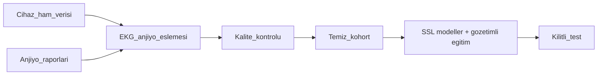
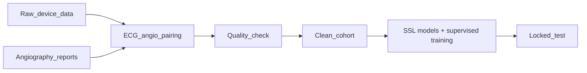

# EKG'den Koroner Darlık Tahmini — Anjiyo Eşlemeli Klinik Kohort ve SSL EKG Modelleri

*Predicting Coronary Stenosis from ECG — An Angiography-Paired Clinical Cohort and SSL ECG Models*

[Türkçe](#türkçe) · [English](#english)

> **Gizlilik / Confidentiality:** Bu sayfa yapılan çalışmayı ve yaklaşımı özetler; kaynak kod ve veri, **hasta gizliliği, fikri mülkiyet (IP) ve NDA** kapsamında paylaşılmaz. / This page summarizes the work and approach; source code and data are not shared because of **patient privacy, IP, and NDA** obligations.

---

## Türkçe

### Özet

**Cormetry Health** bünyesinde yürütülen, dinlenme 12 derivasyon EKG'den anjiyografik olarak anlamlı koroner darlığı tahmin etmeyi hedefleyen bir araştırma projesi. **Yaklaşık 1000 hastanın EKG'sini anjiyo raporlarıyla birlikte toplayıp işledim** ve kayıtları analiz edip ayıran bir kohort hattı kurdum. Öz-denetimli (SSL) ön-eğitilmiş EKG temel modellerini (ECG-FM, HuBERT-ECG, ST-MEM, xECG) gözetimli ince ayarla bu kohorta uyarlayıp, kilitli test kümesinde precision öncelikli karar kuralıyla karşılaştırdım. Hekimlerin etiketleme yaparken zorlanmaması için, aynı hastanın EKG'sini ve anjiyo raporunu tek bir uygulamada gösteren ve etiketlemeyi sağlayan **yerel bir EKG görüntüleme ve etiketleme uygulaması** (PySide6) geliştirdim.

| | |
|---|---|
| **Rol** | Medikal Yapay Zeka Mühendisi. Klinik veri toplama süreci, ~1000 hastalık kohort hattı, SSL model eğitimi ve etiketleme uygulaması |
| **Dönem** | 2026 |
| **Kurum** | Cormetry Health Teknoloji A.Ş. |
| **Alan** | Kardiyoloji / medikal yapay zeka |
| **Veri** | ~1000 hasta, 12 derivasyon EKG + koroner anjiyografi raporu |
| **Çekirdek teknolojiler** | Python, PyTorch, scikit-learn, SciPy, Hugging Face, PySide6 |

**Öne çıkanlar**

- **~1000 hastalık** EKG + anjiyo kohortu toplandı, işlendi ve kaliteye göre ayrıldı.
- Ham cihaz verisi doğru biçimde okunup işlendi; ekran **filtreleri cihazın resmi görüntüleyicisiyle karşılaştırılarak doğrulandı**.
- Tüm kayıtlar kalite ve eşleşme açısından analiz edildi; **kullanılabilir / kontrol gerektiren / dışlanan** gruplara ayrıldı.
- **SSL ön-eğitilmiş EKG temel modelleri** ile **gözetimli ince ayar (supervised fine-tuning)** yapıldı ve modeller tek bir kilitli test kümesinde karşılaştırıldı.
- Hekimler için **EKG ve anjiyo raporunu tek ekranda gösteren** yerel bir görüntüleme ve etiketleme uygulaması geliştirildi.

### Problem

- **Amaç:** Dinlenme EKG'sinden ana koroner damarlarda (LAD, Cx, RCA) **≥ %50 darlığı** tahmin etmek.
- **Referans (ground truth):** İnvaziv koroner anjiyografi raporu.
- **Zorluk:** Klinik kohort, sıfırdan derin ağ eğitmek için küçüktür. Bu yüzden büyük açık EKG verisinde etiketsiz ön-eğitilmiş modellerden yararlanıldı.

### Veri toplama

- **~1000 hastanın** 12 derivasyon EKG kaydını ve koroner anjiyografi raporunu topladım.
- Her EKG, aynı hastanın anjiyo raporuyla eşleştirildi.
- Hasta kimlikleri analiz aşamasında kayıt numaralarıyla değiştirildi.

### Ham verinin işlenmesi ve filtre doğrulaması

- Cihazın ham kayıtları, sinyalin doğru ölçek ve zaman bilgisiyle elde edilmesi için dikkatle okunup işlendi.
- Sinyal, her modelin beklediği giriş biçimine dönüştürüldü.
- Ekranda kullanılan filtreler, aynı kaydın cihazın kendi görüntüleyicisindeki hâliyle karşılaştırılarak doğrulandı.

### Kohort analizi ve ayrım

- Tüm kayıtlar sinyal kalitesi, EKG–anjiyo eşleşmesi ve zaman uygunluğu açısından analiz edildi.
- Kayıtlar **kullanılabilir**, **kontrol gerektiren** ve **dışlanan** olarak üç gruba ayrıldı; kaynak verilere dokunulmadı.
- Anjiyo raporlarından damar bazında darlık etiketleri yapılandırılmış biçimde çıkarıldı.
- Kayıt düzeyinde **tek bir kilitli eğitim / doğrulama / test bölmesi** oluşturuldu; tüm modeller aynı bölmeyi kullandı.

### Modelleme

- Büyük açık EKG verisinde **öz-denetimli (SSL)** ön-eğitilmiş birden fazla EKG temel modeli (ECG-FM, HuBERT-ECG, ST-MEM, xECG) ve gözetimli bir referans model karşılaştırıldı.
- Bu modellerin üzerine küçük kohortta **gözetimli eğitim / ince ayar** yapıldı.
- **Karar kuralı:** Pozitif bir tahmin hastayı invaziv bir müdahaleye yönlendirebileceği için karar eşiği **precision öncelikli** seçildi. Eşik yalnızca doğrulama kümesinde belirlendi; test kümesi yalnızca son değerlendirmede kullanıldı.

### Klinik EKG görüntüleme ve etiketleme uygulaması

- Hekimlerin etiketleme yaparken zorlanmaması için onlara özel bir masaüstü uygulaması geliştirildi.
- **Tek uygulamada**, aynı hastanın **12 derivasyon EKG'si** ve **anjiyo raporu** birlikte görüntülenir ve etiketlenir.
- EKG, klinik standartlara uygun kâğıt görünümünde ve ayarlanabilir filtrelerle gösterilir.
- Ritim, ileti bozuklukları, iskemi, hipertrofi gibi kategorilerde yapılandırılmış etiketleme yapılır.
- Etiketler, karıştırıcı faktörleri işaretlemek ve modelin açıklanabilirlik analizinde kullanılmak üzere toplanır.
- Uygulama tamamen yerel çalışır; hasta verisi makineden çıkmaz.

### Gizlilik ve etik

- Hasta adı içeren dosyalar sürüm kontrolüne girmez; analizlerde kayıt numaraları kullanılır.
- Etiketleme tamamen yerel çalışır; hasta verisi hiçbir sunucuya yüklenmez.
- Üretici yazılımı yalnızca referans görüntüleyici olarak kullanıldı; tersine mühendislik yapılmadı.

### Rolüm

- Medikal Yapay Zeka Mühendisi olarak klinik veri toplama sürecinde yer aldım; ~1000 hastalık EKG–anjiyo kohortunun toplanmasını ve işlenmesini uçtan uca yürüttüm.
- Ham cihaz verisinin işlenmesi, filtre doğrulaması ve kalite kontrolü.
- Kohort analizi, eşleme ve kilitli veri bölme hattının geliştirilmesi.
- SSL temel modelleri (ECG-FM, HuBERT-ECG, ST-MEM, xECG) üzerinde gözetimli ince ayar ve precision öncelikli değerlendirme.
- Hekimlerle birlikte klinik EKG görüntüleme ve etiketleme uygulamasının geliştirilmesi.

### Durum

Araştırma projesi. Sonuçlar makalede raporlanacaktır. Kod ve veri, hasta gizliliği ve **IP / NDA** nedeniyle paylaşılmamaktadır.

---

## English

### Summary

A research project at **Cormetry Health** that aims to predict angiographically significant coronary stenosis from a resting 12-lead ECG. I collected and processed **ECGs from about 1000 patients together with their angiography reports**, and built a cohort pipeline that analyzes and splits the records. I adapted self-supervised (SSL) pretrained ECG foundation models (ECG-FM, HuBERT-ECG, ST-MEM, xECG) to this cohort with supervised fine-tuning and compared them on a locked test set with a precision-first decision rule. So that clinicians could label recordings in one place, I built a **local ECG viewing and labeling app** (PySide6) that shows the same patient's ECG and angiography report together.

| | |
|---|---|
| **Role** | Medical AI Engineer. Clinical data collection process, ~1000-patient cohort pipeline, SSL model training, and labeling app |
| **Period** | 2026 |
| **Organization** | Cormetry Health Teknoloji A.Ş. |
| **Domain** | Cardiology / medical AI |
| **Data** | ~1000 patients, 12-lead ECG + coronary angiography report |
| **Core technologies** | Python, PyTorch, scikit-learn, SciPy, Hugging Face, PySide6 |

**Highlights**

- Collected and processed an ECG + angiography cohort of **~1000 patients**, then split the records by quality.
- Raw device data was read and processed correctly; display **filters were verified against the device's official viewer**.
- All records were analyzed for quality and pairing, and split into **usable / needs-review / excluded** groups.
- **SSL-pretrained ECG foundation models** with **supervised fine-tuning**, compared on one locked test set.
- A local viewing and labeling app for doctors that **shows the ECG and the angiography report on one screen**.

### Problem

- **Goal:** Predict **≥ 50% stenosis** in the main coronary arteries (LAD, Cx, RCA) from a resting ECG.
- **Ground truth:** The invasive coronary angiography report.
- **Challenge:** The clinical cohort is too small to train a deep network from scratch, so models pretrained without labels on large public ECG data were used.

### Data collection

- Collected 12-lead ECG recordings and coronary angiography reports from **~1000 patients**.
- Each ECG was paired with the same patient's angiography report.
- Patient identities were replaced with record IDs for analysis.

### Raw data processing and filter verification

- The device's raw recordings were carefully read and processed so the signal has the correct scale and timing.
- The signal was converted to the input format each model expects.
- The display filters were verified by comparing the same recording with its rendering in the device's own viewer.

### Cohort analysis and split

- All records were analyzed for signal quality, ECG–angiography pairing, and timing.
- Records were split into three groups: **usable**, **needs review**, and **excluded**; source data was never modified.
- Per-vessel stenosis labels were extracted from the angiography reports in a structured form.
- One record-level **locked train / validation / test split** was created; every model used the same split.

### Modeling

- Several ECG foundation models pretrained with **self-supervised learning (SSL)** on large public ECG data (ECG-FM, HuBERT-ECG, ST-MEM, xECG) were compared with a supervised baseline.
- **Supervised training / fine-tuning** was done on top of these models on the small cohort.
- **Decision rule:** A positive prediction can send a patient toward an invasive procedure, so the decision threshold is **precision-first**. The threshold is set on the validation set only; the test set is used only for the final evaluation.

### Clinical ECG viewing and labeling app

- A desktop app was built specifically for doctors so that labeling is not a burden.
- In **one app**, the same patient's **12-lead ECG** and **angiography report** are viewed together and labeled.
- The ECG is shown in a clinical-standard paper view with adjustable filters.
- Structured labeling covers categories such as rhythm, conduction disorders, ischemia, and hypertrophy.
- Labels are collected to flag confounders and to support the model's explainability analysis.
- The app runs fully locally; patient data never leaves the machine.

### Privacy and ethics

- Files containing patient names are kept out of version control; analyses use record IDs.
- Labeling runs fully locally; no patient data is uploaded to any server.
- The vendor software was used only as a reference viewer; no reverse engineering was done.

### My role

- As a Medical AI Engineer, took part in the clinical data collection process and managed the collection and processing of the ~1000-patient ECG–angiography cohort end to end.
- Raw device data processing, filter verification, and quality control.
- Built the cohort analysis, pairing, and locked data-split pipeline.
- Supervised fine-tuning of SSL foundation models (ECG-FM, HuBERT-ECG, ST-MEM, xECG) and precision-first evaluation.
- Built the clinical ECG viewing and labeling app together with clinicians.

### Status

Research project. Results will be reported in the paper. Code and data are not shared because of patient privacy and **IP / NDA**.
