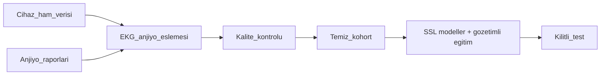
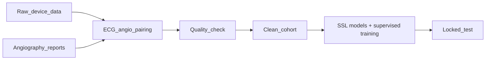

# Klinik EKG–Anjiyo Kohort Hattı ve Etiketleme İş İstasyonu

*Clinical ECG–Angiography Cohort Pipeline and Labeling Workstation*

[Türkçe](#türkçe) · [English](#english)

> **Gizlilik / Confidentiality:** Bu sayfa yapılan çalışmayı ve yaklaşımı özetler; kaynak kod ve veri, **hasta gizliliği, fikri mülkiyet (IP) ve NDA** kapsamında paylaşılmaz. / This page summarizes the work and approach; source code and data are not shared because of **patient privacy, IP, and NDA** obligations.

---

## Türkçe

### Özet

**Cormetry Health**’te **~1000 hastalık** bir EKG–anjiyo kohortunun toplanmasını ve işlenmesini uçtan uca yürüttüm. Ham cihaz örnekleri doğru ölçek ve zamanla okundu, filtreler cihazın resmi görüntüleyicisiyle doğrulandı, kayıtlar kalite ve eşleşmeye göre kullanılabilir / kontrol / dışlanan kümelerine ayrıldı. Önceden eğitilmiş EKG temel modelleri gözetimli bir değerlendirme hattına alındı ve kilitli test kümesinde **precision öncelikli** bir karar kuralıyla karşılaştırıldı. Hekimler aynı hastanın EKG’sini ve anjiyo raporunu birlikte görsün diye yerel bir masaüstü uygulama (PySide6) geliştirdim.

| | |
|---|---|
| **Rol** | Software Engineer, Cormetry Health. Klinik kohort hattı, model entegrasyonu ve etiketleme iş istasyonu |
| **Dönem** | 2026 |
| **Kurum** | Cormetry Health Teknoloji A.Ş. |
| **Alan** | Klinik veri hattı / model entegrasyonu |
| **Veri** | ~1000 hasta, 12 derivasyon EKG + koroner anjiyografi raporu |
| **Çekirdek teknolojiler** | Python, PyTorch, scikit-learn, SciPy, Hugging Face, PySide6 |

**Öne çıkanlar**

- **~1000 hastalık** EKG–anjiyo kohortu toplandı, işlendi ve kalite ile eşleşmeye göre ayrıldı.
- Ham cihaz verisi doğru ölçek ve zamanla okundu; **filtreler cihazın resmi görüntüleyicisiyle doğrulandı**.
- Kayıtlar **kullanılabilir / kontrol gerektiren / dışlanan** gruplara ayrıldı.
- Önceden eğitilmiş EKG temel modelleri kilitli bir değerlendirme hattında, **precision öncelikli** bir karar kuralıyla karşılaştırıldı.
- Hekimler için **EKG ve anjiyo raporunu tek ekranda gösteren** yerel etiketleme uygulaması (PySide6).

### Problem

- **Amaç:** Dinlenme EKG'sinden ana koroner damarlarda (LAD, Cx, RCA) **≥ %50 darlığı** tahmin etmek.
- **Referans (ground truth):** İnvaziv koroner anjiyografi raporu.
- **Zorluk:** Klinik kohort, sıfırdan derin ağ eğitmek için küçüktür. Bu yüzden büyük açık EKG verisinde etiketsiz ön-eğitilmiş modellerden yararlanıldı.

### Veri toplama

- **~1000 hastanın** 12 derivasyon EKG kaydını ve koroner anjiyografi raporunu topladım.
- Her EKG, aynı hastanın anjiyo raporuyla eşleştirildi.
- Hasta kimlikleri analiz aşamasında kayıt numaralarıyla değiştirildi.

### Ham verinin işlenmesi ve filtre doğrulaması

- Cihazın ham kayıtları, sinyalin doğru ölçek ve zaman bilgisiyle elde edilmesi için dikkatle okunup işlendi.
- Sinyal, her modelin beklediği giriş biçimine dönüştürüldü.
- Ekranda kullanılan filtreler, aynı kaydın cihazın kendi görüntüleyicisindeki hâliyle karşılaştırılarak doğrulandı.

### Kohort analizi ve ayrım

- Tüm kayıtlar sinyal kalitesi, EKG–anjiyo eşleşmesi ve zaman uygunluğu açısından analiz edildi.
- Kayıtlar **kullanılabilir**, **kontrol gerektiren** ve **dışlanan** olarak üç gruba ayrıldı; kaynak verilere dokunulmadı.
- Anjiyo raporlarından damar bazında darlık etiketleri yapılandırılmış biçimde çıkarıldı.
- Kayıt düzeyinde **tek bir kilitli eğitim / doğrulama / test bölmesi** oluşturuldu; tüm modeller aynı bölmeyi kullandı.

### Modelleme

- Büyük açık EKG verisinde **öz-denetimli (SSL)** ön-eğitilmiş birden fazla EKG temel modeli (ECG-FM, HuBERT-ECG, ST-MEM, xECG) ve gözetimli bir referans model karşılaştırıldı.
- Bu modellerin üzerine küçük kohortta **gözetimli eğitim / ince ayar** yapıldı.
- **Karar kuralı:** Pozitif bir tahmin hastayı invaziv bir müdahaleye yönlendirebileceği için karar eşiği **precision öncelikli** seçildi. Eşik yalnızca doğrulama kümesinde belirlendi; test kümesi yalnızca son değerlendirmede kullanıldı.

### Klinik EKG görüntüleme ve etiketleme uygulaması

- Hekimlerin etiketleme yaparken zorlanmaması için onlara özel bir masaüstü uygulaması geliştirildi.
- **Tek uygulamada**, aynı hastanın **12 derivasyon EKG'si** ve **anjiyo raporu** birlikte görüntülenir ve etiketlenir.
- EKG, klinik standartlara uygun kâğıt görünümünde ve ayarlanabilir filtrelerle gösterilir.
- Ritim, ileti bozuklukları, iskemi, hipertrofi gibi kategorilerde yapılandırılmış etiketleme yapılır.
- Etiketler, karıştırıcı faktörleri işaretlemek ve modelin açıklanabilirlik analizinde kullanılmak üzere toplanır.
- Uygulama tamamen yerel çalışır; hasta verisi makineden çıkmaz.

### Gizlilik ve etik

- Hasta adı içeren dosyalar sürüm kontrolüne girmez; analizlerde kayıt numaraları kullanılır.
- Etiketleme tamamen yerel çalışır; hasta verisi hiçbir sunucuya yüklenmez.
- Üretici yazılımı yalnızca referans görüntüleyici olarak kullanıldı; tersine mühendislik yapılmadı.

### Rolüm

- Software Engineer olarak ~1000 hastalık EKG–anjiyo kohort hattını ve etiketleme iş istasyonunu uçtan uca yürüttüm. İlgili: [EKG platformu](../../../2024-2025/medical/cormetry-ecg-platform/README.md) · [PTB-XL hattı](../ecg-ptbxl-ensemble/README.md).
- Ham cihaz verisinin işlenmesi, filtre doğrulaması ve kalite kontrolü.
- Kohort analizi, eşleme ve kilitli veri bölme hattının geliştirilmesi.
- SSL temel modelleri (ECG-FM, HuBERT-ECG, ST-MEM, xECG) üzerinde gözetimli ince ayar ve precision öncelikli değerlendirme.
- Hekimlerle birlikte klinik EKG görüntüleme ve etiketleme uygulamasının geliştirilmesi.

### Durum

Kohort hattı ve yerel etiketleme uygulaması. Kod ve veri, hasta gizliliği ve **IP / NDA** nedeniyle paylaşılmaz.

---

## English

### Summary

At **Cormetry Health** I ran collection and processing for an ECG–angiography cohort of **~1000 patients** end to end. Raw device samples were read at the correct scale and timing, filters were verified against the device's official viewer, and records were gated into usable / review / excluded sets by quality and pairing. Pretrained ECG foundation models were placed on a supervised evaluation pipeline and compared on a locked test set under a **precision-first** decision rule. I built a local desktop app (PySide6) so clinicians can view the same patient's ECG and angiography report together.

| | |
|---|---|
| **Role** | Software Engineer, Cormetry Health. Clinical cohort pipeline, model integration, and labeling workstation |
| **Period** | 2026 |
| **Organization** | Cormetry Health Teknoloji A.Ş. |
| **Domain** | Clinical data pipeline / model integration |
| **Data** | ~1000 patients, 12-lead ECG + coronary angiography report |
| **Core technologies** | Python, PyTorch, scikit-learn, SciPy, Hugging Face, PySide6 |

**Highlights**

- Collected and processed an ECG–angiography cohort of **~1000 patients**, then gated records by quality and pairing.
- Raw device data was read at the correct scale and timing; **filters were verified against the device's official viewer**.
- Records were split into **usable / needs-review / excluded** groups.
- Pretrained ECG foundation models were compared on a locked evaluation pipeline under a **precision-first** decision rule.
- A local labeling app (PySide6) that **shows the ECG and the angiography report on one screen**.

### Problem

- **Goal:** Predict **≥ 50% stenosis** in the main coronary arteries (LAD, Cx, RCA) from a resting ECG.
- **Ground truth:** The invasive coronary angiography report.
- **Challenge:** The clinical cohort is too small to train a deep network from scratch, so models pretrained without labels on large public ECG data were used.

### Data collection

- Collected 12-lead ECG recordings and coronary angiography reports from **~1000 patients**.
- Each ECG was paired with the same patient's angiography report.
- Patient identities were replaced with record IDs for analysis.

### Raw data processing and filter verification

- The device's raw recordings were carefully read and processed so the signal has the correct scale and timing.
- The signal was converted to the input format each model expects.
- The display filters were verified by comparing the same recording with its rendering in the device's own viewer.

### Cohort analysis and split

- All records were analyzed for signal quality, ECG–angiography pairing, and timing.
- Records were split into three groups: **usable**, **needs review**, and **excluded**; source data was never modified.
- Per-vessel stenosis labels were extracted from the angiography reports in a structured form.
- One record-level **locked train / validation / test split** was created; every model used the same split.

### Modeling

- Several ECG foundation models pretrained with **self-supervised learning (SSL)** on large public ECG data (ECG-FM, HuBERT-ECG, ST-MEM, xECG) were compared with a supervised baseline.
- **Supervised training / fine-tuning** was done on top of these models on the small cohort.
- **Decision rule:** A positive prediction can send a patient toward an invasive procedure, so the decision threshold is **precision-first**. The threshold is set on the validation set only; the test set is used only for the final evaluation.

### Clinical ECG viewing and labeling app

- A desktop app was built specifically for doctors so that labeling is not a burden.
- In **one app**, the same patient's **12-lead ECG** and **angiography report** are viewed together and labeled.
- The ECG is shown in a clinical-standard paper view with adjustable filters.
- Structured labeling covers categories such as rhythm, conduction disorders, ischemia, and hypertrophy.
- Labels are collected to flag confounders and to support the model's explainability analysis.
- The app runs fully locally; patient data never leaves the machine.

### Privacy and ethics

- Files containing patient names are kept out of version control; analyses use record IDs.
- Labeling runs fully locally; no patient data is uploaded to any server.
- The vendor software was used only as a reference viewer; no reverse engineering was done.

### My role

- As a Software Engineer, ran the ~1000-patient ECG–angiography cohort pipeline and the labeling workstation end to end. Related: [ECG platform](../../../2024-2025/medical/cormetry-ecg-platform/README.md) · [PTB-XL pipeline](../ecg-ptbxl-ensemble/README.md).
- Raw device data processing, filter verification, and quality control.
- Built the cohort analysis, pairing, and locked data-split pipeline.
- Supervised fine-tuning of SSL foundation models (ECG-FM, HuBERT-ECG, ST-MEM, xECG) and precision-first evaluation.
- Built the clinical ECG viewing and labeling app together with clinicians.

### Status

Cohort pipeline and local labeling app. Code and data are not shared because of patient privacy and **IP / NDA**.
