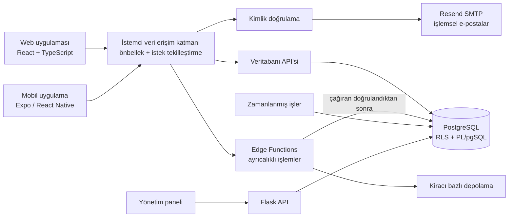
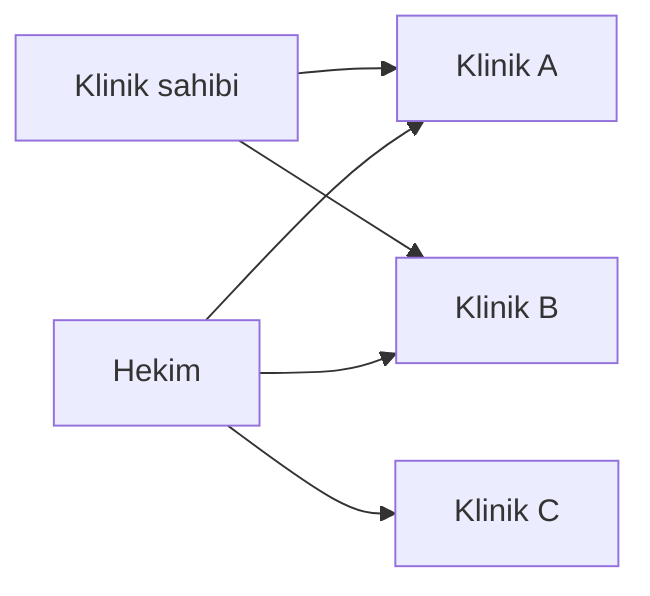
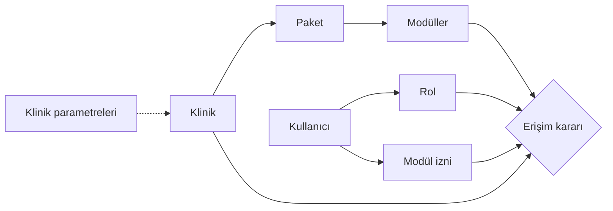
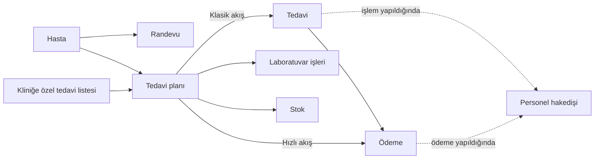
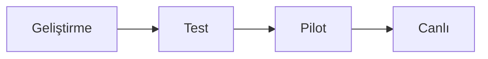
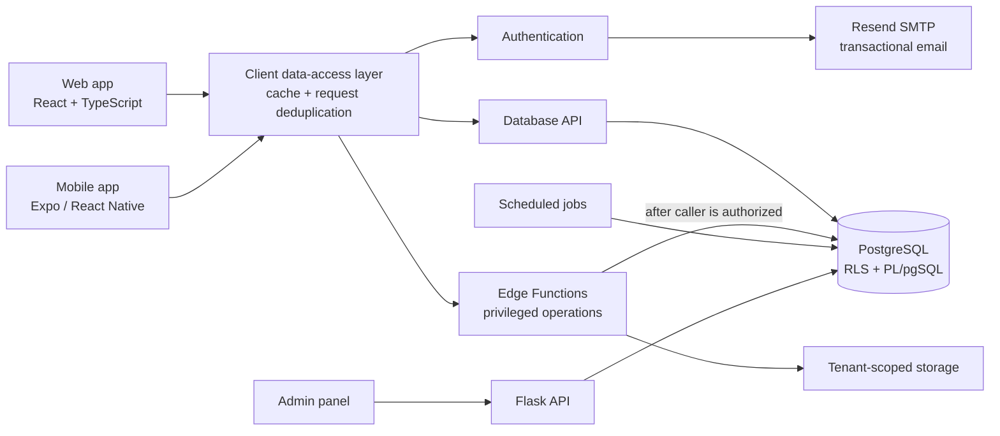
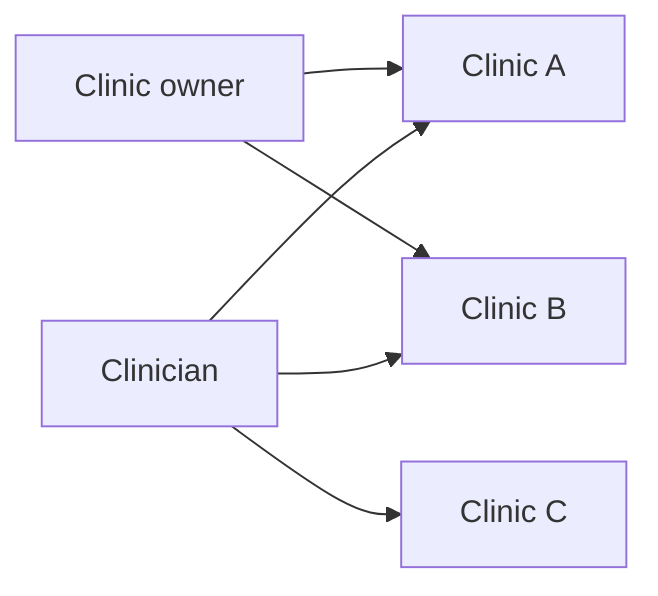
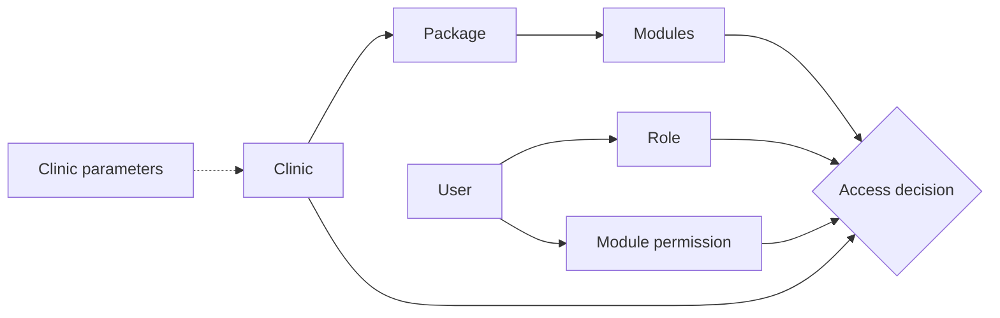
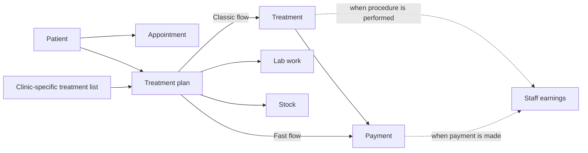
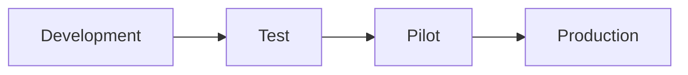

# Clinovatech — Multi-Tenant B2B SaaS Platform (Backend Engineering)

[Türkçe](#türkçe) · [English](#english)

> **Gizlilik / Confidentiality:** Bu sayfa ticari bir ürün için yapılan işi ve mimari yaklaşımı özetler; kaynak kod **fikri mülkiyet (IP) ve NDA** kapsamında paylaşılmaz. / This page summarizes work on a commercial product; source code is not shared under **IP and NDA** obligations.

---

## Türkçe

### Özet

Klinikler için multi-tenant B2B SaaS **backend’ini, veritabanı düzeyinde RLS dahil, Yazılım Mühendisi (Backend & Sistemler) olarak uçtan uca tasarladım ve geliştirdim**. Kapsam; veri modeli, çok kiracılık ve veri izolasyonu, yetkilendirme modeli, serverless katman, istemci veri erişim katmanı ve yeni özelliklerin geliştirme, test ve pilot ortamları üzerinden canlıya alınma sürecidir.

| | |
|---|---|
| **Rol** | Yazılım Mühendisi (Backend & Sistemler), Sözleşmeli. Multi-tenant backend’in, veritabanı düzeyinde RLS dahil, uçtan uca tasarımı ve geliştirilmesi |
| **Dönem** | 2025 – 2026 |
| **Alan** | Sağlık / klinik yönetimi, diş klinikleri odaklı B2B SaaS |
| **İstemciler** | Web (React + TypeScript), mobil (Expo / React Native) |
| **Çekirdek teknolojiler** | Supabase (PostgreSQL, Auth, Storage), PL/pgSQL, Edge Functions (Deno), Python (Flask), TypeScript |

**Öne çıkanlar**

- Kiracı izolasyonu uygulama kodunda değil, **veritabanı düzeyinde (Row Level Security)** zorunlu kılınır.
- **3 abonelik paketi, ~20 modül**; paket, modül ve kullanıcı izinleri kod değişikliği olmadan yapılandırılır.
- **Çok klinikli yapı:** Bir klinik sahibi birden fazla kliniğe sahip olabilir, bir hekim birden fazla klinikte görev alabilir.
- Klinik üyeliği, paket kapsamı, rol ve modül izni **tek bir yetki kararında** birleşir; aynı karar veritabanında ve arayüzde kullanılır.
- Ayrıcalıklı işlemler yalnızca **sunucu tarafında, yetki doğrulamasından sonra** çalışır.
- Web ve mobil istemciler **aynı backend'i ve aynı yetki modelini** paylaşır.
- **Flask API tabanlı merkezi yönetim paneli:** Tüm klinik sistemi tek bir panelden yönetilir.

### Problem ve bağlam

Platform, farklı büyüklükteki kliniklere tek bir kod tabanından hizmet veriyor. Bu durum üç temel gereksinim doğurdu:

1. **Veri izolasyonu:** Bir kliniğin verisi, hiçbir koşulda başka bir kliniğe görünmemeli; tek bir unutulmuş filtre bile veri sızıntısına yol açmamalı.
2. **Esnek ticari model:** Paketler ve modüller satış ihtiyaçlarına göre değişebilmeli, gerektiğinde tek bir kliniğe özel paket tanımlanabilmeli.
3. **Tutarlı finansal veri:** Ödeme, tedavi ve personel hakedişi gibi birbirine bağlı kayıtlar web ve mobilde her zaman aynı sonucu göstermeli.

### Mimari genel bakış

- **Model:** Serverless / Backend-as-a-Service (BaaS). İş kuralları ağırlıklı olarak veritabanı katmanında ve izole serverless fonksiyonlarda konumlandırıldı.
- **Çok kiracılık:** Paylaşımlı veritabanı ve şema; izolasyon veritabanı politikalarıyla zorunlu kılınır.
- **İstemciler:** Web ve mobil uygulama aynı backend'e, aynı yetki modeliyle bağlanır.
- **Frontend organizasyonu:** Özellik tabanlı katmanlı yapı; veri erişimi arayüz bileşenlerinden ayrılmıştır.
- **Tasarım sistemi:** Tek kaynaktan üretilen tema yapısı, sözleşme testleriyle otomatik doğrulanır.

### Çok klinikli sahiplik ve çalışma

Birçok klinik yönetim yazılımında her klinik sahibi tek bir kliniğe bağlıdır. Platforma, gerçek hayattaki zincir klinik ve çok şubeli çalışma düzenini destekleyen bir özellik ekledim:

- **Çoklu klinik sahipliği:** Bir klinik sahibi, tek bir hesapla birden fazla kliniğe sahip olabilir ve hepsini yönetebilir.
- **Birden fazla klinikte çalışan hekimler:** Aynı hekim, ayrı hesap açmadan birden fazla klinikte görev alabilir.
- **Klinikler arası izolasyon korunur:** Kullanıcı birden fazla kliniğe bağlı olsa da her kliniğin verisi ayrı kalır; erişim, kullanıcının o klinikteki üyeliğine göre belirlenir.

### Yapılandırılabilir ürün mimarisi

Platformun merkezinde, ürünün kod değişikliği gerektirmeden klinik bazında şekillendirilebildiği bir yapı var:

- **Kullanıcı bazlı sistem ve rol yetkilendirmesi:** Her kullanıcı bir veya birden fazla kliniğe üyedir. Erişim, kullanıcının rolüne ve kendisine atanmış modül izinlerine göre belirlenir.
- **3 abonelik paketi, ~20 modül:** Modüller paketlerden bağımsız tanımlanır ve **paketler arasında taşınabilir**. Bir modülün hangi pakette yer alacağı yapılandırma ile belirlenir.
- **Paketler, modüller ve kullanıcı izinleri birbirinden bağımsız yapılandırılır.** Bu sayede:
  - Standart paketlerin dışında **tek bir kliniğe özel paket** tanımlanabilir.
  - **Klinik parametreleri** ile her kliniğin davranışı ve limitleri ayrı ayrı özelleştirilebilir.
  - Kullanıcıya, kliniğin paketi kapsamındaki modüller arasından yalnızca ihtiyaç duyduğu erişim verilir.
- **Katmanlı erişim kararı:** klinik üyeliği → paket kapsamı → kullanıcının rolü ve modül izni. Aynı karar hem veritabanı politikalarında hem arayüzde kullanılır; tek doğruluk kaynağı vardır.
- **Otomatik tutarlılık:** Paket değiştiğinde kapsam dışında kalan izinler otomatik olarak temizlenir.

### Merkezi yönetim paneli (Flask API)

Platformun operasyonel yönetimi için **Flask API tabanlı bir yönetim paneli** geliştirdim. Tüm klinik sistemi bu tek panelden yönetilir:

- **Klinik yönetimi:** Kliniklerin, sahiplerinin ve kullanıcılarının tek yerden yönetimi.
- **Paket ve modül yapılandırması:** Paketlerin, modüllerin ve kliniğe özel paketlerin kod değişikliği olmadan panelden düzenlenmesi.
- **Klinik parametreleri:** Klinik bazlı davranış ve limitlerin panelden ayarlanması.

Böylece yukarıda anlatılan yapılandırılabilir ürün mimarisi, teknik olmayan operasyon ekibi tarafından da kullanılabilir hale geldi.

### İşlemsel e-posta altyapısı (Resend SMTP)

Kimlik doğrulama akışlarının e-postalarını **Resend üzerinden SMTP** ile gönderecek şekilde kurguladım:

- **Kayıt:** Yeni kullanıcı kaydında e-posta doğrulaması.
- **Şifre işlemleri:** Şifre sıfırlama ve şifre değiştirme e-postaları.
- **Diğer hesap bildirimleri:** Kimlik doğrulama akışlarındaki diğer hesap e-postaları.

### Diş kliniklerine yönelik iş modülleri

Diş klinikleri için geliştirdiğim temel iş modülleri, birbirine bağlı tek bir akış içinde çalışır:

- **Randevu sistemi:** Hasta randevularının planlanması ve takibi.
- **Klinik bazlı özelleştirilebilir tedavi listeleri:** Her klinik kendi tedavi listesini tanımlayıp düzenleyebilir; tedavi planları bu listeden oluşturulur.
- **Klinik bazlı seçilebilir tedavi akışı:** Hasta kartında plan kaydedildikten sonraki adımları belirler. Her klinik kendi çalışma şekline uygun akışı seçer; her adım geçişi ilgili kayıtları otomatik günceller.
  - **Klasik akış:** Plan → Tedavi → Ödeme
  - **Hızlı akış:** Plan → Ödeme (tedavi adımı ayrıca takip edilmez)
- **Hasta yönetimi:** Ödeme ve tedavi durumlarıyla bağlantılı hasta listesi.
- **Personel bazlı hakediş hesaplama:** Her personel için hakedişin hangi anda hesaplanacağı ayrı ayrı seçilir: **ödeme yapıldığında** ya da **işlem yapıldığında**. Hakedişler hasta ve tedaviye bağlı olarak hesaplanır; ödeme veya işlem durumu değiştikçe tutarlar tutarlı kalır.
- **Stok modülü:** Klinik malzeme ve sarf takibi.
- **Laboratuvar modülü:** Laboratuvar işlerinin hasta ve tedaviyle ilişkili takibi.

Tedavi listesi ve tedavi akışı klinik bazında, hakediş hesaplama yöntemi ise personel bazında özelleştirilebilir; böylece aynı platform farklı çalışma düzenlerine sahip kliniklere kod değişikliği olmadan uyum sağlar. Bu modüller de paket–modül yapısının parçasıdır; klinik bazında paketlere eklenip çıkarılabilir.

### Güvenlik ve veri izolasyonu

- **Veritabanı düzeyinde kiracı izolasyonu:** Row Level Security sayesinde her sorgu yalnızca kullanıcının üye olduğu kliniklerin verisini görür.
- **Varsayılan olarak güvenli:** Veri katmanı, korumasız bir veri yüzeyi bırakmayacak şekilde tasarlandı.
- **Yetki yükseltme koruması:** Rol ve yetki değişiklikleri yalnızca kontrollü akışlarla yapılabilir.
- **Değiştirilemez denetim kaydı (audit log):** Kritik işlemler izlenebilir ve kayıtlar sonradan değiştirilemez.
- **İzole ayrıcalıklı işlemler:** Yüksek yetki gerektiren işlemler yalnızca sunucu tarafında, çağıranın yetkisi doğrulandıktan sonra çalışır.
- **Dosya güvenliği:** Kiracı bazında izole depolama, süreli erişim ve kiracı bazlı kotalar.

### Veri tutarlılığı, performans ve güvenilirlik

- **Atomik yazmalar:** Çok adımlı ve çok varlıklı yazmalar tek bir transaction içinde çalışır.
- **Türetilmiş değerler veritabanında:** Durum, bakiye ve tahakkuk gibi değerler veritabanında otomatik senkronize edilir; web ve mobil için tek doğruluk kaynağı oluşur.
- **Soft delete:** Silinen kayıtlar veri kaybı olmadan geri izlenebilir.
- **Idempotent periyodik işler:** Zamanlanmış işler tekrar çalıştırıldığında yan etki üretmez.
- **İstemci önbelleği:** TTL destekli önbellek ve eşzamanlı aynı isteklerin tekilleştirilmesi.
- **Oturum kurtarma:** Oturum süresi dolduğunda kullanıcı akışı kesilmez.
- **Frontend performansı:** Route düzeyinde lazy loading ve chunk ayrımı.

### Sürüm ve ortam hattı

Yeni özellikleri geliştirme, test ve pilot ortamlarından canlıya aldım. Her özellik, son kullanıcıya ulaşmadan önce kademeli olarak ayrı ortamlardan geçer:

- **Geliştirme (dev):** Özelliğin geliştirildiği ve ilk doğrulamanın yapıldığı ortam.
- **Test:** Özelliğin canlıya benzer koşullarda doğrulandığı ortam.
- **Pilot:** Özelliğin sınırlı sayıda klinikte gerçek kullanımla denendiği ortam.
- **Canlı (production):** Pilotta doğrulanan özelliğin tüm kliniklere açılması.

### Temel mühendislik kararları

| Problem | Yaklaşım | Sonuç |
|---|---|---|
| Kiracılar arası veri sızıntısı | İzolasyon uygulama kodundan veritabanı politikalarına taşındı | "Unutulan filtre" sınıfındaki hatalar yapısal olarak engellendi |
| Satır düzeyi güvenliğin performans maliyeti | Yetki kontrolleri performans odaklı optimize edildi | Güvenlik, sorgu performansından ödün vermeden korundu |
| Paket, rol ve kullanıcı izninin birleştirilmesi | Katmanlı, tek bir yetki kararı | Paket değişiminde tutarlılık otomatik korunur |
| Bir sahibin birden fazla kliniği, bir hekimin birden fazla klinikte çalışması | Kullanıcı ile klinik arasında esnek bir üyelik modeli | Tek hesapla çoklu klinik; klinikler arası veri izolasyonu korunur |
| Klinik bazlı özelleştirme ihtiyacı | Paket–modül ilişkisi ve klinik parametreleri | Kod dallanması olmadan kliniğe özel paket ve davranış |
| Finansal değerlerin tutarlılığı | Atomik transaction'lar ve veritabanında türetilen değerler | Web ve mobil her zaman aynı sonucu gösterir |
| Ayrıcalıklı işlemlerin güvenliği | Yüksek yetkili işlemler ve anahtarlar yalnızca sunucu tarafında tutuldu | Ayrıcalıklı işlemler yalnızca doğrulanmış sunucu tarafında çalışır |
| Eşzamanlı istekler ve yarış durumları | İstek tekilleştirme ve idempotent işler | Tekrarlanan yazmalar ve tutarsız durumlar önlendi |
| Kaynak kullanımı ve denetlenebilirlik | Kiracı bazlı kotalar ve değiştirilemez audit log | Kaynak sınırları ve izlenebilir işlem geçmişi |

### Teknoloji yığını

- **Backend / veri:** Supabase (PostgreSQL, Auth, Storage), PL/pgSQL, zamanlanmış veritabanı işleri.
- **Serverless:** Supabase Edge Functions (Deno).
- **Yönetim paneli:** Python, Flask API.
- **E-posta:** Resend (SMTP).
- **Frontend:** React 19, TypeScript, Vite, React Router, i18next, zengin metin editörü, grafikler, Excel/PDF dışa aktarım.
- **Mobil:** Expo, React Native.
- **Kalite:** ESLint, TypeScript tip kontrolü, tasarım sistemi sözleşme testleri, bundle analizi.

> **Gizlilik:** Bu belge mimari yaklaşımı ve çözülen problemleri özetler. Kaynak kod ve uygulama detayları, fikri mülkiyet ve gizlilik sözleşmesi (NDA) kapsamında paylaşılmaz.

---

## English

### Summary

As a **Software Engineer (Backend & Systems)**, I **designed and developed the multi-tenant B2B SaaS backend for clinics end to end, including database-level RLS**. The scope covers the data model, multi-tenancy and data isolation, the authorization model, the serverless layer, the client data-access layer, and the release process that takes new features through development, test, and pilot environments to production.

| | |
|---|---|
| **Role** | Software Engineer (Backend & Systems), Contract. End-to-end design and development of the multi-tenant backend, including database-level RLS |
| **Period** | 2025 – 2026 |
| **Domain** | Healthcare / clinic management, B2B SaaS focused on dental clinics |
| **Clients** | Web (React + TypeScript), mobile (Expo / React Native) |
| **Core technologies** | Supabase (PostgreSQL, Auth, Storage), PL/pgSQL, Edge Functions (Deno), Python (Flask), TypeScript |

**Highlights**

- Tenant isolation is enforced **at the database level (Row Level Security)**, not in application code.
- **3 subscription packages, ~20 modules**; packages, modules, and user permissions are configured without code changes.
- **Multi-clinic model:** One clinic owner can own multiple clinics, and one clinician can work at multiple clinics.
- Clinic membership, package scope, role, and module permission combine into **a single authorization decision**, used by both the database and the UI.
- Privileged operations run only **on the server side, after authorization checks**.
- Web and mobile clients share **the same backend and the same authorization model**.
- **Central admin panel built on a Flask API:** The entire clinic system is managed from a single panel.

### Problem and context

The platform serves clinics of different sizes from a single codebase. That created three core requirements:

1. **Data isolation:** One clinic's data must never be visible to another, and a single forgotten filter must not be able to cause a leak.
2. **A flexible commercial model:** Packages and modules must change with sales needs, including a custom package for a single clinic when required.
3. **Consistent financial data:** Linked records such as payments, treatments, and staff earnings must always show the same result on web and mobile.

### Architecture overview

- **Model:** Serverless / Backend-as-a-Service (BaaS). Business rules live mainly in the database layer and in isolated serverless functions.
- **Multi-tenancy:** Shared database and schema; isolation is enforced by database policies.
- **Clients:** The web and mobile apps connect to the same backend with the same authorization model.
- **Frontend organization:** Feature-based layered structure; data access is separated from UI components.
- **Design system:** Theme generated from a single source and validated automatically by contract tests.

### Multi-clinic ownership and staffing

Many clinic management products tie each clinic owner to a single clinic. I added a feature that supports how clinic chains and multi-location practices actually work:

- **Multi-clinic ownership:** One clinic owner can own and manage multiple clinics from a single account.
- **Clinicians working at multiple clinics:** The same clinician can work at several clinics without separate accounts.
- **Isolation between clinics is preserved:** Even when a user belongs to several clinics, each clinic's data stays separate; access is determined by the user's membership in that specific clinic.

### Configurable product architecture

At the core of the platform is a structure that lets the product be shaped per clinic without code changes:

- **User-based system with role authorization:** Each user is a member of one or more clinics. Access is decided by the user's role and the module permissions assigned to them.
- **3 subscription packages, ~20 modules:** Modules are defined independently of packages and are **portable across packages**. Which package a module belongs to is a configuration change.
- **Packages, modules, and user permissions are configured independently of each other.** This enables:
  - a **custom package for a single clinic**, beyond the standard tiers;
  - **per-clinic customization** of behavior and limits through **clinic parameters**;
  - granting each user only the modules they need within the clinic's package scope.
- **Layered access decision:** clinic membership → package scope → user role and module permission. The same decision is used in database policies and in the UI, giving a single source of truth.
- **Automatic consistency:** When a package changes, permissions that fall out of scope are cleaned up automatically.

### Central admin panel (Flask API)

I built an **admin panel on top of a Flask API** for operating the platform. The entire clinic system is managed from this single panel:

- **Clinic management:** Clinics, their owners, and their users managed in one place.
- **Package and module configuration:** Packages, modules, and clinic-specific packages edited from the panel without code changes.
- **Clinic parameters:** Per-clinic behavior and limits adjusted from the panel.

This made the configurable product architecture described above usable by the non-technical operations team as well.

### Transactional email (Resend SMTP)

I set up the authentication emails to be sent **over SMTP through Resend**:

- **Sign-up:** Email verification for new user registration.
- **Password flows:** Password reset and password change emails.
- **Other account notifications:** Other account emails in the authentication flows.

### Business modules for dental clinics

The core business modules I built for dental clinics work as one connected flow:

- **Appointment system:** Scheduling and tracking of patient appointments.
- **Per-clinic customizable treatment lists:** Each clinic defines and edits its own treatment list; treatment plans are built from this list.
- **Per-clinic selectable treatment flow:** Defines the steps that follow once a plan is saved on the patient record. Each clinic picks the flow that matches how it works; every step change updates the related records automatically.
  - **Classic flow:** Plan → Treatment → Payment
  - **Fast flow:** Plan → Payment (the treatment step is not tracked separately)
- **Patient management:** Patient list linked to payment and treatment status.
- **Per-staff earnings calculation:** For each staff member, the moment earnings (commission) are calculated is chosen individually: **when payment is made** or **when the procedure is performed**. Earnings are calculated per patient and treatment, and stay consistent as payment or procedure status changes.
- **Stock module:** Tracking of clinic materials and consumables.
- **Laboratory module:** Tracking of laboratory work linked to the patient and treatment.

The treatment list and treatment flow can be customized per clinic, and the earnings calculation method per staff member, so the same platform fits clinics with different ways of working without code changes. These modules are also part of the package–module structure and can be added to or removed from packages per clinic.

### Security and data isolation

- **Database-level tenant isolation:** With Row Level Security, every query only sees data from clinics the user belongs to.
- **Secure by default:** The data layer is designed so that no unprotected data surface is left exposed.
- **Privilege-escalation protection:** Role and permission changes are possible only through controlled flows.
- **Immutable audit log:** Critical operations are traceable, and records cannot be modified afterwards.
- **Isolated privileged operations:** High-privilege actions run only on the server side, after the caller's authorization is verified.
- **File security:** Tenant-isolated storage, time-limited access, and per-tenant quotas.

### Data consistency, performance, and reliability

- **Atomic writes:** Multi-step, multi-entity writes run in a single transaction.
- **Derived values in the database:** Status, balances, and accruals are kept in sync inside the database, giving one source of truth for web and mobile.
- **Soft delete:** Deleted records remain traceable without data loss.
- **Idempotent periodic jobs:** Scheduled jobs produce no side effects when re-run.
- **Client-side cache:** TTL-based cache and deduplication of identical concurrent requests.
- **Session recovery:** Session expiry does not interrupt the user flow.
- **Frontend performance:** Route-level lazy loading and chunk splitting.

### Release and environment pipeline

I shipped new features from development through test and pilot into production. Before reaching end users, every feature moves step by step through separate environments:

- **Development:** Where the feature is built and first verified.
- **Test:** Where the feature is validated under production-like conditions.
- **Pilot:** Where the feature is tried with real usage in a limited number of clinics.
- **Production:** The feature, validated in pilot, is rolled out to all clinics.

### Key engineering decisions

| Problem | Approach | Outcome |
|---|---|---|
| Cross-tenant data leakage | Isolation moved from application code into database policies | "Forgotten filter" bugs are structurally prevented |
| Performance cost of row-level security | Authorization checks optimized for performance | Security kept without sacrificing query performance |
| Unifying package, role, and user permission | A single, layered authorization decision | Consistency preserved automatically on package changes |
| One owner with multiple clinics, one clinician at multiple clinics | A flexible user–clinic membership model | Multiple clinics from a single account, with isolation between clinics preserved |
| Per-clinic customization | Package–module relationships and clinic parameters | Clinic-specific packages and behavior without code branches |
| Consistency of financial values | Atomic transactions and values derived in the database | Web and mobile always show the same result |
| Safety of privileged operations | High-privilege operations and keys kept strictly on the server side | Privileged actions run only on the verified server side |
| Concurrent requests and race conditions | Request deduplication and idempotent jobs | Duplicate writes and inconsistent states prevented |
| Resource usage and auditability | Per-tenant quotas and an immutable audit log | Resource limits and a traceable operation history |

### Tech stack

- **Backend / data:** Supabase (PostgreSQL, Auth, Storage), PL/pgSQL, scheduled database jobs.
- **Serverless:** Supabase Edge Functions (Deno).
- **Admin panel:** Python, Flask API.
- **Email:** Resend (SMTP).
- **Frontend:** React 19, TypeScript, Vite, React Router, i18next, rich-text editor, charts, Excel/PDF export.
- **Mobile:** Expo, React Native.
- **Quality:** ESLint, TypeScript type checking, design-system contract tests, bundle analysis.

> **Confidentiality:** This document summarizes the architectural approach and the problems solved. Source code and implementation details are not shared, under intellectual property and non-disclosure (NDA) obligations.
